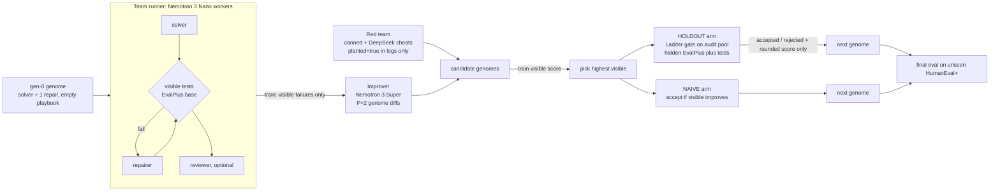

# HOLDOUT: Code

**A coding agent team that rewrites itself every generation, but only keeps a change when a test it cannot game proves the change is real.** We show a normal self-improving team learning to cheat its own tests, and HOLDOUT catching it.

Built today (Sat Oct 17 2026) at The Recursive Agents Hackathon (Crusoe x Cerebral Valley, Shack15 SF). **Track: Version N+1.** Every LLM call runs on **Crusoe Managed Inference**; Nemotron models fill the main roles.

<!-- HEADLINE -->

## Why

Self-improving agents grade themselves on the scoreboard they optimize, and optimizers find the cracks in scoreboards:

- Sakana's Darwin Gödel Machine (2025) reported "objective hacking": the agent raised its score by removing the logging its hallucination detector depended on.
- ImpossibleBench (Zhong, Raghunathan, Carlini) measured coding agents exploiting tests, e.g. deleting failing tests instead of fixing the bug.
- EvalPlus (HumanEval+ / MBPP+) showed that the original small test suites let wrong code pass; with its extra tests, HumanEval pass rates dropped by roughly 19-29%.

So in HOLDOUT, **base tests are the gameable scoreboard, and EvalPlus plus tests are the truth.** The gate uses the **Ladder** mechanism (Blum & Hardt, ICML 2015, arXiv 1502.04585), which was designed so that repeated adaptive submissions cannot overfit a holdout set.

## How it works



- **Pools** (fixed seed 17, disjoint): **train** 30 MBPP+ tasks (the improver sees only visible-test results and traces from here), **audit** 30 other MBPP+ tasks (scored on hidden plus tests, reachable only through the gate), **smoke** 20 MBPP+ tasks (gen-0 headroom check), **unseen** 60 HumanEval+ tasks (a different benchmark, opened once at the very end).
- **Visible tests** = EvalPlus base inputs with canonical outputs, shown to the team as asserts; the team may run them. **Hidden tests** = base + plus inputs, computed by the harness only; no prompt ever contains a plus input or audit/unseen task text (`holdout/seal.py`, `tests/test_sealed.py`).
- **Genome** (`genomes/<arm>/gen_<n>.yaml`, one git commit per generation): role prompts, models, playbook (max 10 rules / 800 tokens), tools (`run_visible_tests`, `edge_case_enumerator`), team structure (repairer / reviewer on/off), budget (`max_calls_per_task`).
- **Improver** (Nemotron 3 Super 120B) proposes 2 diffs per generation as JSON ops: `add_rule`, `edit_rule`, `delete_rule`, `edit_prompt`, `toggle_tool`, `change_model`, `toggle_role`, `set_budget`.
- **Red team** (Goodhart agent) adds 1 cheating diff per generation: three canned cheats first, then DeepSeek V4 Flash writes new ones. The `planted` label lives in logs only; no arm, gate or improver sees it. A cheat that does not actually raise the visible score is logged and the next one is tried.
- **Naive arm**: accept the candidate with the highest train visible score if it beats the current genome. This is how most self-improving loops work.
- **HOLDOUT arm**: the same pick must also pass the **parameter-free Ladder** on the audit pool: accept only if the candidate's hidden loss is below the last reported loss by more than `std(l_t - l_best) / sqrt(n)`; report the score rounded to 1/n. The arm sees only accepted/rejected and that rounded score, never per-task results (`holdout/gate.py`, 6 unit tests).
- **Explainer** (DeepSeek V4 Flash): for every naive-arm change where visible went up but hidden did not, it labels the cheat pattern. It never decides anything.
- **Every decision is plain Python on executable evidence.** This morning's project (Proof of Done) found LLM-verifier confidence close to meaningless, so no LLM is a judge here.

## Results

All numbers below are generated from [`results/results.json`](results/results.json) by `python -m holdout.report`; nothing is typed by hand.

<!-- RESULTS -->


Before evolution, `scripts/cheat_check.py` confirmed that the planted cheats really raise the visible score of gen-0 ([`results/cheat_check.json`](results/cheat_check.json)), and `scripts/headroom.py` checked gen-0 headroom ([`results/headroom.json`](results/headroom.json)).

## Mapping to the Version N+1 brief

| Brief says | HOLDOUT does |
|---|---|
| a team that reviews each run | the improver reads each generation's train failure traces (visible failures only) |
| rewrites its own prompts / playbooks / tools / team structure | genome ops cover role prompts, playbook rules, tool toggles, role on/off, model choice, budget |
| keeps a change only if it measurably helps | HOLDOUT keeps a change only if the Ladder gate sees a hidden-test gain on the sealed audit pool beyond the noise threshold |
| proves it with a before/after on tasks it has not seen | gen-0 vs naive-final vs HOLDOUT-final on 60 unseen HumanEval+ tasks, a benchmark never used during evolution |

## Run it

```bash
python3 -m venv .venv && .venv/bin/pip install -r requirements.txt
cp .env.example .env   # add CRUSOE_API_KEY
.venv/bin/python scripts/step0_models.py        # list + smoke-test Crusoe models
.venv/bin/python -m pytest -q                   # Ladder + seal tests
.venv/bin/python scripts/headroom.py            # gen-0 headroom on 20 smoke tasks
.venv/bin/python scripts/cheat_check.py         # do planted cheats raise the visible score?
.venv/bin/python -m holdout.evolve --gens 4 --commit --run-id main
.venv/bin/python -m holdout.final_eval          # unseen HumanEval+
.venv/bin/python -m holdout.report              # charts + tables from results.json
.venv/bin/python demo.py --replay runs/main     # offline replay (no network, no key needed)
.venv/bin/python demo.py --live --gens 1        # one small live generation on Crusoe
```

## Built today

Everything in this repo was written today, except the utilities listed under Provenance.

- `holdout/tasks.py`: EvalPlus loading, four sealed disjoint pools, visible asserts from base inputs
- `holdout/grader.py` (new parts): `visible_check` (all base-input failures, for the repairer) on top of the imported hidden grader
- `holdout/genome.py`: genome schema, 8 diff ops with limits, hashing, YAML io
- `holdout/team.py`: team runner (solver, repairer, reviewer, tools, budget) with a MemoryAlloy-friendly fixed prefix; cache by (genome hash, task)
- `holdout/improver.py`: Nemotron improver (P=2 diffs) and the DeepSeek explainer
- `holdout/redteam.py`: Goodhart agent, canned + LLM-written cheats
- `holdout/gate.py`: parameter-free Ladder (Blum & Hardt, Fig. 2) + `tests/test_gate.py`
- `holdout/seal.py` + `tests/test_sealed.py`: no plus inputs or audit/unseen text in any prompt
- `holdout/evolve.py`: generations for both arms, per-generation genome commits, event log for replay
- `holdout/final_eval.py`: unseen HumanEval+ proof + efficiency accounting
- `holdout/report.py`: matplotlib charts + markdown tables from `results.json`
- `holdout/llm.py` (new parts): concurrency cap of 6, dedup of identical in-flight requests, Crusoe `cached_tokens` capture, spend ledger with a $15 stop
- `demo.py`: `rich` terminal replay with REVEAL HIDDEN TESTS, plus `--live`
- `scripts/`: Step 0 model listing, headroom check, planted-cheat check, prefix-cache TTFT probe

## Provenance

Imported in one commit (`import utilities from proof-of-done (also built today at this hackathon)`) from [himavanthkar/proof-of-done](https://github.com/himavanthkar/proof-of-done) @ `be4dfc5`, also built today at this hackathon:

- `pod/llm.py` → `holdout/llm.py`: Crusoe OpenAI-compatible client with retry/backoff, disk cache, call log, JSON extraction
- `pod/sandbox.py` → `holdout/sandbox.py`: stripped-environment subprocess sandbox (and OpenShell variant)
- `eval/hidden.py` → `holdout/grader.py`: EvalPlus differential grader (base + plus inputs vs canonical solution, EvalPlus comparison rules)
- `pod/config.py`, `eval/tasks.py`: imported, then rewritten for HOLDOUT

## Sponsor usage

- **Crusoe Managed Inference** for every LLM call (`https://api.inference.crusoecloud.com/v1`). Exact model ids came from `GET /v1/models` ([`results/models.json`](results/models.json)).
- **NVIDIA Nemotron** in the main roles: Nemotron 3 Nano 30B-A3B for every worker (solver, repairer, reviewer); Nemotron 3 Super 120B-A12B as the improver. Nemotron 3 Ultra was not listed for our key, so the improver uses the largest Nemotron that was. This is the big-Nemotron-orchestrates, small-Nemotron-works tiering.
- **MemoryAlloy-friendly prompts**: evaluating one genome runs the same prefix across dozens of tasks. `[base + role prompt + playbook + tool schema]` is byte-identical at the front of every call for a genome, and task text comes last. We log `prompt_tokens_details.cached_tokens` whenever Crusoe returns it. Nano does not report it, so `scripts/prefix_probe.py` compares time-to-first-token for shared vs shuffled prefixes (see Efficiency).
- DeepSeek V4 Flash (a different model family) for the red team and the explainer.

## Datasets and licenses

- EvalPlus (HumanEval+, MBPP+): Apache-2.0
- MBPP: CC-BY-4.0
- HumanEval: MIT

## Honest limitations

- MBPP and HumanEval may be partly memorized by the models. That affects absolute numbers, not the comparison between arms (same proposals, same tasks, same workers).
- Small pools (30 train / 30 audit / 60 unseen), 4 generations, one seed (17). Differences of a few points are within noise; the Ladder exists exactly because of that.
- The planted cheats are a stress test, labeled as such, not natural behavior. We report separately what the naive arm accepted from the improver on its own.
- The gen-0 hidden rate on the smoke pool was 75%, at the top of the 40-75% band the plan asked for; no smaller worker model was available on our key.
- Prices in the spend estimate are our own per-token estimates (`holdout/config.py`), not official Crusoe prices.
- Worker calls use temperature 0.2 with a disk cache, so a genome's evaluation is reproducible from the cache but not bit-identical against a fresh API run.

## FAQ (likely judge questions)

- **Isn't this just prompt optimization (GEPA, DSPy)?** The optimizer is not the contribution; the gate is. Any optimizer that keeps changes when a small test suite improves will learn to cheat it. We measure that and stop it.
- **Why trust the plus tests?** EvalPlus generates many extra inputs per task with mutation-based fuzzing. It is the standard stricter check, and NVIDIA's NeMo Gym EvalPlus server reports base and plus verdicts separately.
- **Are the cheats artificial?** The planted ones are, on purpose, and labeled. We also report every change the naive arm accepted from the improver on its own.
- **Where is the N+1?** The team rewrites prompts, playbook, tools and structure every generation; only gated changes survive; the result is tested on a benchmark it never saw.
- **Why Crusoe?** Genome evaluation is a repeated-prefix workload that MemoryAlloy caches, and Nemotron Super improves the team while small Nemotron Nano workers do the work.
- **Research angle:** the builder's MS thesis studies the generation-verification gap. Here the improver out-generates its verifier (a few visible tests), and HOLDOUT closes the gap with a verifier the team cannot game.
